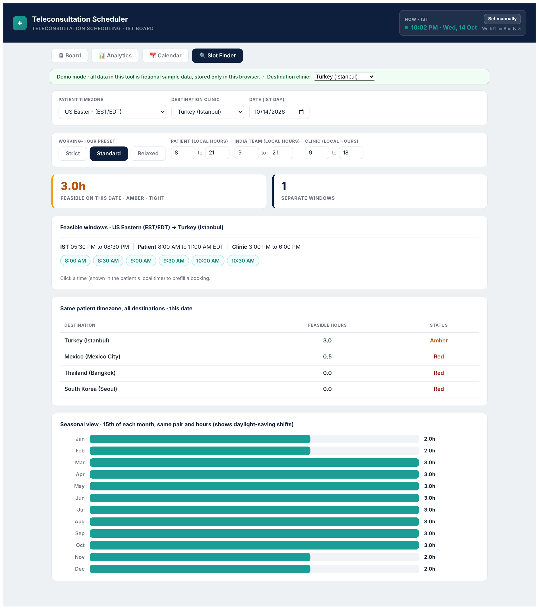
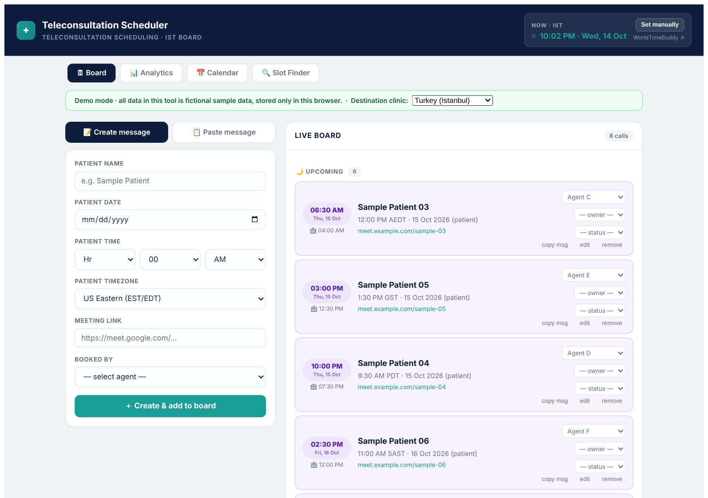
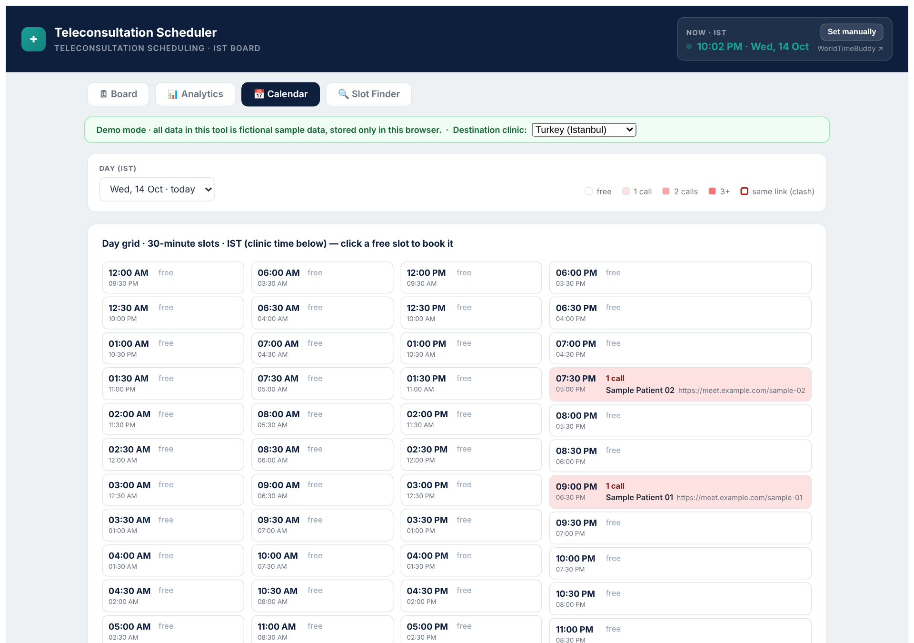

# Teleconsultation Slot Finder

A three-party time-zone overlap model and a small web tool for finding feasible teleconsultation windows in cross-border medical tourism.

A slot is **feasible** only when all three parties are inside their local working window at the same instant:

1. the patient (21 regions in the model, 23 time zones in the app picker),
2. the India operations team (Asia/Kolkata),
3. the destination clinic (Turkey, Mexico, Thailand, South Korea).

Time zones come from the IANA tz database, so daylight-saving shifts are handled. Resolution is 30 minutes.

> **Data notice.** This repository contains no company, patient or staff data. The working-hour windows are stated assumptions. All names, times and links in the web tool are fictional sample data generated at load time.

## Preview

**Live app:** https://mithilesh9mk.github.io/teleconsult-slot-finder/

GitHub shows the code but does not run the app. These screenshots are from the sample-data build.

**Slot Finder**



**Board** (fictional sample patients)



**Calendar**



## What is in here

| Folder | Contents |
|---|---|
| `model/` | Python simulation (`model.py`), routing tiers (`routing.py`), seasonal and sensitivity analysis (`extra.py`), heatmap (`heatmap.py`) |
| `results/` | `results.csv` (252 rows = 84 region-destination pairs x 3 scenarios), routing matrix, figures |
| `app/` | React + Vite scheduler with the Slot Finder tab, and `crosscheck.mjs` which verifies the JS finder against the Python model |

## Scenarios (local hours, assumptions)

| Scenario | Patient | India team | Clinic |
|---|---|---|---|
| Strict | 09-20 | 09-18 | 09-18 |
| Standard | 08-21 | 09-21 | 09-18 |
| Relaxed | 07-22 | 08-23 | 08-20 |

Routing tiers (Standard hours): **Green** = mean of at least 4 feasible hours per day with a window every day; **Amber** = mean of at least 1 hour; **Red** = under 1 hour; **Red (none)** = never feasible.

## Run the model

```bash
cd model
pip install pandas matplotlib      # Python 3.9+ (zoneinfo)
python model.py                    # writes ../results/results.csv
python routing.py                  # routing tiers
python extra.py                    # seasonal swing and sensitivity
python heatmap.py                  # figure
```

The simulation is deterministic and exhaustive: every date of 2026 is evaluated for every pair. Results reproduce byte for byte. There is no sampling, so no significance tests are reported.

## Run the web tool

```bash
cd app
npm install
npm run dev                        # http://localhost:5173
```

Open the **Slot Finder** tab, choose the patient region and destination, pick a date, and adjust the working-hour windows. It shows feasible windows in IST, patient time and clinic time, a comparison across all destinations, and a month-by-month view that exposes daylight-saving effects. Clicking a time pre-fills a booking on the Board tab.

Data is kept in your browser's `localStorage` only. Nothing is transmitted.

### Verify the JS finder against Python

```bash
cd app
node crosscheck.mjs src/TC_Scheduler.jsx
```

All 14 test cases (two dates x seven region-destination pairs) match the Python model.

## Limitations

- Feasibility is not outcome. The model says when a call can happen, not whether it improves conversion or satisfaction.
- Working windows are assumptions. Real teams, clinics and patients differ; edit `SCENARIOS` in `model/model.py`.
- Public holidays, clinic-specific schedules and doctor availability are not modelled.
- One year (2026) is evaluated.

## Citation

If you use this work, please cite the accompanying paper (details to be added on publication).

## Licence

MIT. See `LICENSE`.

## Author

Mithilesh Virendra Kale. [LinkedIn](https://www.linkedin.com/in/mithileshkalemk9)
